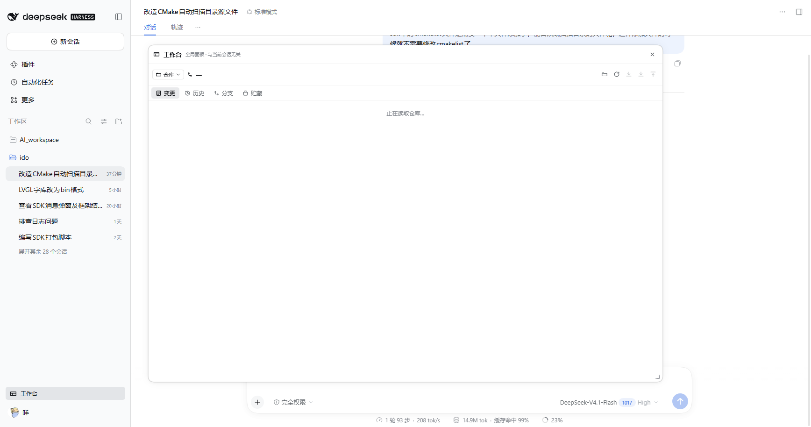

# dsh-workbench-dock

> 在 **左侧栏顶部**（与「插件 / 自动化任务 / 更多」同一排）加一个「工作台」入口；点开后 **停靠到会话右侧，一边是会话、一边是工作台，两边同时可用**。同一份状态、同一组页面，与具体会话无关。**不使用 dsh-better-sidebar。**



## 为什么是全局浮层

DSH 自带的右侧栏是 **按会话隔离** 的：它的布局存在 `state.bySession[sessionId]` 里，每个对话各有一份。而工作台要的是「一个共用的地方」——同一批 Git 仓库、同一个 Downloader 串口状态，切会话不该丢。

所以本插件不往任何会话槽位里挤，而是自己拥有一个 `position: fixed` 浮层：一个 DOM 节点、一个开关、状态里没有任何 sessionId。

## 形态

```
左侧栏顶部（与 插件 / 自动化任务 / 更多 同一排）
  └─ [工作台]   ← sidebar.panellist，无需打开会话即可见

点击 → 停靠到会话右侧（默认）
   ┌──────────────────────┬─────────────────────┐
   │                      │ 工作台  已停靠右侧    │
   │      会话            │ [GitCraft][Downloader]│
   │  （可正常输入、滚  │ ─────────────────── │
   │    动、执行工具）    │   当前页面的内容      │
   └──────────────────────┴─────────────────────┘
```

- **默认停靠**：右侧让出一列给工作台，会话缩到左侧，**两边都能操作**（不是遮罩浮层）；
- 标题栏可切换 **停靠 ⇄ 浮动窗口**；
- 拖动工作台左边缘调整宽度，宽度与模式都记在 localStorage；
- `Esc` 关闭；只有 1 个页面时隐藏内部 Tab 条。

### 停靠是怎么实现的（不改 DSH 内部）

工作台自己占一个 `position: fixed` 的右侧列，并把宽度写进 CSS 变量
`--wbd-dock-width`；同时给 `<body>` 加 `wbd-docked-open` 类，样式规则给 body
加同宽 `padding-right`。于是宿主应用只是在一个更窄的盒子里布局，**没有被 fork、
没有被重渲染**，会话仍然是原来那个会话。

## 给插件写页面

页面是 React 组件，只能在浏览器侧注册。注册表放在**一个浏览器全局**上，两个 bundle 的加载顺序无所谓：

```js
const dock = window.__DSH_WORKBENCH_DOCK__
dock.registerPage({
  id: 'myplugin',
  title: '我的页面',
  order: 40,
  icon: (size) => <Icon size={size} />,
  component: ({ t, dock }) => <MyPanel />,
})
```

若 dock 还没加载（全局为 undefined），短轮询等它出现即可 —— GitCraft 与 Downloader 都这么做。

> **已知约束**：跨 bundle 的页面注册有过一次真实事故 —— 页面先注册进一个 stub 对象，dock 后加载时新建对象覆盖了它，导致浮层显示「没有页面」而后台 `list()` 却有 1 个。现在的实现让 dock **采纳**已存在的对象（把控制面嫁接到同一个对象上），并且浮层每 250ms 重读一次页面表，不再依赖订阅时序。

## 安装

```powershell
dsh plugin --profile desktop add 'file:<repo>/packages/dock'
# 或：profile 的 dependencies 写 "dsh-workbench-dock": "file:<repo>/packages/dock"，再 pnpm install
```

装完**重启 DSH**。左侧栏顶部（与「插件 / 自动化任务 / 更多」同一排）出现「工作台」；若宿主版本没有那一排，会自动退到左侧栏底部。

## 测试

```powershell
node tests/split.e2e.mjs <base-url> <browser-exe> <repo-path> [shot.png]   # 17 项
node tests/row-click.e2e.mjs <base-url> <browser-exe>                     #  2 项
node tests/interaction.e2e.mjs <base-url> <browser-exe>                   # 10 项
```

- **split.e2e（17）**：入口位置、停靠分屏、会话仍可用、选择器全盘选仓库、路径实时校验。
- **row-click.e2e（2）**：点击行内**文字区域**（离图标 150px 以上）也能打开。
- **interaction.e2e（10）**：点击 Downloader 页签、点面板内部、点其它侧栏行、切走再回来 —— 工作台都不该关；再点一次入口才关。

### 三个已经踩过、不要退回去的坑

**1. 不要用 `element.click()` 测入口。**
合成事件绕过命中测试。曾经「真实鼠标点不动」的 bug 因此全绿地发版出去；测试必须用 `Input.dispatchMouseEvent`。

**2. 「行」必须从实测 DOM 里取，不能靠 `closest` 猜。**
实测结构（这是唯一可靠依据）：

```
SPAN   .wbd-entryBtn        28x28   role="button"   ← 插件自己的元素
DIV    (display:contents)
SPAN   .wtg9ga_panelGlyph   28x28
BUTTON .wtg9ga_panelRow     252x42  text "工作台"    ← 真正的「行」
NAV    .wtg9ga_panelList    256x156 text "插件 自动化任务 工作台 更多"
```

由此踩了两个坑：

- `closest('button, [role="button"], …')` 会匹配到**自己**（入口也带 `role="button"`），
  于是「行」只有 28px，文字区域全死 —— 用户实测「只有图标能点」。
- 改成「逐层向上找包含自己的祖先」后，会匹配到 `NAV`（它同时包含入口和「插件」行），
  于是点任意侧栏行都会切开关；而面板内部祖先链会走到 `body`，于是**点面板里的页签就把面板关了**。

**正确做法**：`own.parentElement.closest('button, [class*="panelRow"], li')` ——
从父元素起步以跳过自己，只认那一层 `BUTTON`。

**3. 用 `pointerdown` 而不是 `click`。**
宿主把槽位包进它自己的 `<button class="…panelRow">`；`pointerdown` 是交互链第一个事件，
不会被外层抢先，也不会因为行被卸载而丢失。

## License

MIT
