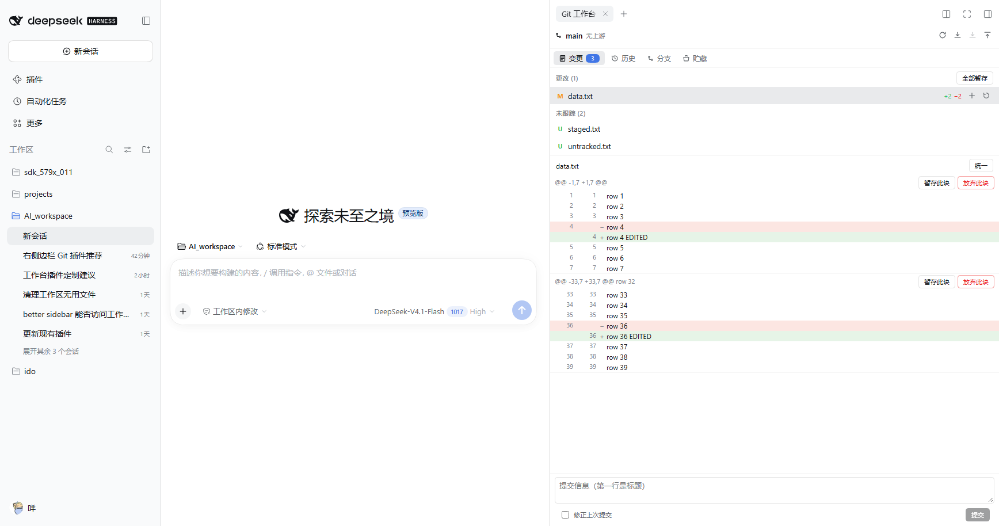
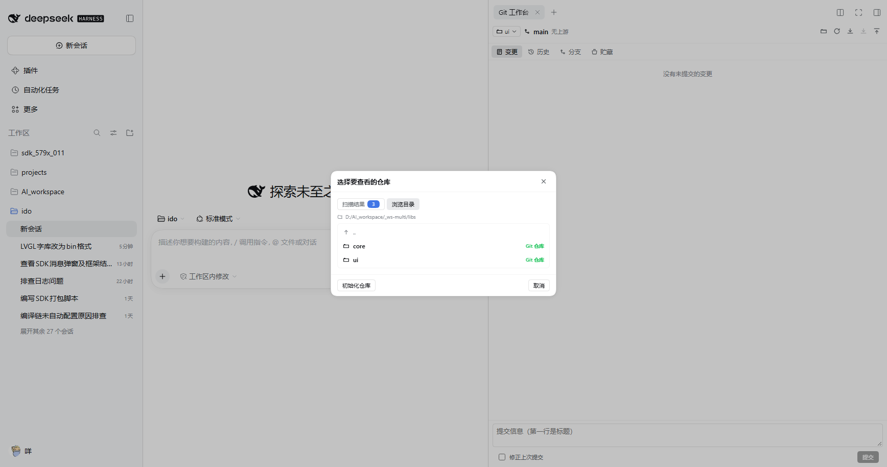

# dsh-gitcraft

> **命名说明**：本插件原名 dsh-git-workbench，但 npm 上已存在同名包（dsh-git-workbench@0.3.4，作者 kaixinbaba），属重名冲突，已更名为 **dsh-gitcraft**（npm 与 GitHub 均无同名）。改名只影响包名、路由前缀与 Tab id，功能不变。


> SourceTree 级 GitCraft，作为 DeepSeek Harness 的侧栏 Tab 运行。自研实现，不包壳、不嵌入任何第三方 GUI。





## 为什么是自研

SourceTree 是 Atlassian 的闭源商业软件（EULA 明确禁止反编译、修改与再分发），无法改造成插件；而现有社区 Git 插件普遍缺少 **hunk 级暂存**、**冲突解决**、**blame / 文件历史 / reflog**。本插件从零实现这四层，并直接挂在 DSH 右侧栏。

## 功能对照

| 能力 | SourceTree | VS Code Git | 本插件 |
|---|---|---|---|
| **hunk 级暂存 / 取消 / 放弃** | ✅ | ✅ | ✅ 逐块按钮 + **行级多选** |
| 逐文件暂存 / 取消 / 丢弃 | ✅ | ✅ | ✅（含批量） |
| 提交 / 修正上次提交 | ✅ | ✅ | ✅（`Ctrl/Cmd+Enter`） |
| 分支树（HEAD / 本地 / 远程 / 标签） | ✅ | 部分 | ✅ 含 ahead/behind |
| 分支新建 / 重命名 / 删除 / 设置上游 | ✅ | ✅ | ✅ 受保护分支需二次确认 |
| 合并 + **冲突解决** | ✅ | ✅ | ✅ ours / theirs / 标记已解决 + 继续 / 中止 |
| 变基（含中止 / 继续） | ✅ | ✅ | ✅ |
| Cherry-pick / Revert / Reset（soft·mixed·hard） | ✅ | ✅ | ✅ hard 需显式确认 |
| Stash（创建 / 应用 / 弹出 / 删除 / 清空） | ✅ | ✅ | ✅ 可含未跟踪、可保留暂存区 |
| Fetch / Pull（ff-only 或 rebase）/ Push | ✅ | ✅ | ✅ 独立网络超时 |
| 标签（轻量 / 附注 / 删除 / 删除远程） | ✅ | 部分 | ✅ |
| 提交图（泳道 + ref 徽章） | ✅ | 扩展 | ✅ 内置，可选紧凑样式 |
| 提交详情 + 逐行 diff（unified / split） | ✅ | ✅ | ✅ |
| **Blame** | ✅ | 扩展 | ✅ 逐行作者/时间/摘要 |
| **文件历史**（`--follow`） | ✅ | 扩展 | ✅ |
| **Reflog** | ✅ | 扩展 | ✅ |
| **多仓库 / 选目录** | ✅ | ✅ | ✅ **扫描工作区内全部仓库 + 逐层浏览**，选择记忆在本地 |

## 安装

```powershell
# 本地目录安装（开发/自用）
dsh plugin --profile desktop add 'file:<repo>/packages/gitcraft'
```

装完**重启 DSH**。打开任意会话 → 右侧边栏 `+` → **GitCraft**；或会话头「打开右侧边栏」→ Guide 里的 **GitCraft** 胶囊。

> 面板是「工作台」插件（`dsh-workbench-dock`）的一个页面：打开任意会话 → 左侧栏的 **工作台** 入口 → 面板里的 **GitCraft** 页。**不使用 `dsh-better-sidebar`**，也不会出现在它的 Tab 栏里。


## 选择仓库（不只扫当前目录）

面板不再局限于「会话 cwd 所在的那一个仓库」：

1. 点头部左侧的**仓库胶囊**（显示当前仓库名）打开选择器；
2. **扫描结果**：宿主递归扫描**整个工作区**，列出其中所有 Git 仓库（按工作区相对路径），带分支名与 HEAD 短哈希；
3. **浏览目录**：逐层下钻，仓库用 Git 仓库 标记；落在仓库子目录里时提供「使用仓库根」；
4. 选中后立即切换，并按浏览器记忆（localStorage），下次打开沿用。

扫描边界：跳过 
ode_modules / dist / build / .venv / vendor / target 等噪声目录，深度 ≤6、访问 ≤4000 个目录、结果 ≤200 个；超限会提示改用「浏览目录」逐层查看。选择器只允许工作区内的目录，rowse 与 
epoRoot 都做 realpath 包含检查。

## 与社区项目的关系（独立实现声明）

本插件是**从零独立实现**，没有复制任何社区插件的源码：

- **代码来源**：src/index.js 与 src/client.js 全部为本项目原创（约 1.7k + 2.2k 行）。
- **参考了什么**：只参考了 DSH 的**公开契约**——dsh.bundle.patch 清单格式、webServer.register({kind:'prefix'}) 路由挂载、window.__ModuleLoader__.load({id, factory}) 客户端入口、ctx.betterSidebar.registerTab 与 ctx.sidebarRightTabs.register 两个 seat 的签名。这些是宿主 API，不是某个插件的私有实现。
- **对照过的实现**：dsh-ide-git（KannaKuron，MIT）与 dsh-better-sidebar（omdsh-dev，MIT）被安装/解包后用于核对 API 形状与坑位（例如 ctx.config 在未 inject 的上下文会抛异常、右侧栏 seat 不传 cwd），结论写进了自己的实现里，没有搬运代码。
- **命名**：见上方「命名说明」。取名冲突是我的疏忽，已修正。
## 设计要点

- **补丁由宿主重算**：客户端不发送补丁文本，只发 `path + hunkIndex + lines`，宿主从实时 diff 重新生成补丁再 `git apply --cached`。过期的面板无法应用不匹配的补丁。
- **行级暂存的正确性**：未选中的 `+` 行从补丁中删除；未选中的 `-` 行转成上下文行，并同步重算 `@@` 计数——这是让部分暂存后文件仍保持「已修改」的关键。
- **写操作按仓库串行化**：同一仓库的写请求排队，避免两个标签页同时写 index。
- **trust fence**：路由挂在 DSH 自己的 web server 上，只服务 loopback 或 `Sec-Fetch-Site: same-origin/same-site` 的请求。
- **argv 数组、无 shell**：所有 git 调用走 `spawn(git, argv)`，参数经校验（绝对路径、ref 不以 `-` 开头、路径不含 `..`、不含 NUL）。
- **双 seat 自适应**：面板测量自身容器宽度，在 `columns / stack / compact` 三种 chrome 间切换；主题全部走 `--dsw-alias-*` token。
- **session 回退**：官方右侧栏 seat 只给 `sessionId`，宿主自行解析会话工作区；解析不到时报 `cwd-unavailable` 而不是崩溃。

## 架构

```
src/index.js    host 半：58 个 RPC 方法、git 执行层、补丁生成、写锁、信任围栏
src/client.js    client 半：单文件 React，向工作台注册一个页面，三种布局，i18n(zh/en)
```

Host 暴露 `POST /dsh-gitcraft/api/<method>`，返回 `{ok:true,data}` 或 `{ok:false,error:{code,message}}`。

## 测试

```powershell
# ---- 单元 / 集成（不需要浏览器）----
node --test tests/host.test.mjs           # 29 项：真实仓库端到端（hunk 暂存、冲突、stash、护栏…）
node --test tests/client.test.mjs         # 14 项：加载器契约、工作台页面注册、i18n、TDZ 守卫、rev 守卫
node --test tests/workspace.test.mjs      # 15 项：工作区扫描、逐层浏览、越界拒绝、深度边界

# ---- 对运行中的 DSH 打真实路由 ----
node tests/live.e2e.mjs <base> <repo>     # 15 项：全部 RPC 方法 + 护栏

# ---- 真实浏览器（CDP 驱动）----
node tests/ui.e2e.mjs <base> <exe> <repo>        # 10 项：变更列表 + hunk 级暂存
node tests/picker.e2e.mjs <base> <exe> <ws>      #  8 项：仓库选择器（扫描 / 下钻 / 切换）
node tests/history.e2e.mjs <base> <exe> <repo>   #  6 项：历史页签渲染（TDZ 回归）
node tests/rev.e2e.mjs <base> <exe> <repo>       #  5 项：提交内看文件 diff（rev is required 回归）
node tests/coverage.e2e.mjs <base> <exe> <repo>  # 19 项：全 UI 路径覆盖
node tests/diff-layout.e2e.mjs <base> <exe> <repo>  # 15 项：列表/diff 独立滚动 + 拖动分隔条
node tests/watch.e2e.mjs <base> <exe> <repo>       #  4 项：空闲不刷新、改文件自动刷新
node tests/history-inline.e2e.mjs <base> <exe> <repo>  #  9 项：历史页就地 diff、可拖拽、无重复 stat 块
node tests/files-scroll.e2e.mjs <base> <exe> <repo>    #  5 项：「变更文件」列表独立滚动
node tests/detail-split.e2e.mjs <base> <exe> <repo>    #  4 项：提交列表/详情可拖拽
node tests/body-scroll.e2e.mjs <base> <exe> <repo>     #  6 项：长提交日志独立滚动
```

`coverage.e2e` 需要一份特制仓库（进行中的冲突 / stash / 多分支 / 多提交 / 三种工作区状态）：

```powershell
pwsh tests/fixture-coverage.ps1 -Repo D:\tmp\covrepo
```

覆盖路径：变更（暂存/取消暂存/提交框）、历史（搜索/详情/标签弹窗/重置弹窗）、分支（列表/新建/删除确认）、
贮藏（新建/应用/删除）、冲突横幅（继续/中止），以及「全部交互后无错误边界、无 rev 报错、无控制台异常」。

## 历史页：就地查看 diff，不再跳走

点提交里的文件，diff **在历史页下方展开**，不再切换「变更」标签页：

```
┌───────────────────────────────┐
│ 搜索提交信息…                  │
│ ● fix: tweak two files   main │  ← 提交列表
│ ● feat: seed three files      │
│ fix: tweak two files          │
│ 560f426 Li Lei 2026/10/30     │
│ [优选到当前分支] [还原] [重置…] │
│ 变更文件 (2)                   │
│   M a.c                       │
│   M b.c                       │
├════════ 拖动调整高度 ══════════┤
│ a.c                  [统一] ✕ │  ← 就地 diff（可关闭）
│ @@ -2,7 +2,7 @@               │
│ - a line 5                    │
│ + a line 5 EDITED             │
└───────────────────────────────┘
```

- **提交正文（日志）限高 + 独立滚动**：正文最长占详情区的 44%，再长就在框内滚，
  「变更文件」不会被长日志顶出视野；
- **「变更文件」列表有自己的滚动条**：滚动它不会把提交标题、作者、操作按钮顶出视野；
- **提交列表与提交详情之间也有一条分隔条**：拖动即可决定详情区多大（默认列表 34%）；
- **提交列表也有自己的滚动条**；
- 外层区域本身不再整体滚动（实测 `mainScrollable: false`）；
- 该区域与下方 diff 之间**有分隔条，可拖动拉大拉小**（默认 55% / 45%，实测拖 120px
  后上方 370→289、diff 249→330）；
- diff 表头 sticky，带「统一/分栏」切换和关闭按钮；
- 切到别的提交时，上一个文件的 diff 自动收起。

> 之前点文件会 `setNav('changes')` 跳到变更页，既丢了正在读的提交，也把两个视图混在一起。

同时去掉了两处重复内容：

- **提交的 `git show --stat` 摘要块** —— 它和下面的「变更文件 (n)」列表是同一批文件，
  而且每次都要多跑一次 `git show`（这台机器约 1.5 秒）。宿主端也一并删掉了那次调用。
- **提交正文框** —— `%B` 自带标题行，没有正文的提交会把标题重复显示一遍。


点提交里的文件，diff **在历史页下方展开**，不再切换「变更」标签页：

```
┌───────────────────────────────┐
│ 搜索提交信息…                  │
│ ● fix: tweak two files   main │  ← 提交列表
│ ● feat: seed three files      │
├───────────────────────────────┤
│ fix: tweak two files          │
│ 560f426 Li Lei 2026/10/30     │
│ [优选到当前分支] [还原] [重置…] │
│ 变更文件 (2)                   │
│   M a.c                       │
│   M b.c                       │
├───────────────────────────────┤
│ a.c                  [统一] ✕ │  ← 就地 diff（可关闭）
│ @@ -2,7 +2,7 @@               │
│ - a line 5                    │
│ + a line 5 EDITED             │
└───────────────────────────────┘
```

> 之前点文件会 `setNav('changes')` 跳到变更页，既丢了正在读的提交，也把两个视图混在一起。

同时去掉了两处重复内容：

- **提交的 `git show --stat` 摘要块** —— 它和下面的「变更文件 (n)」列表是同一批文件，
  而且每次都要多跑一次 `git show`（这台机器约 1.5 秒）。宿主端也一并删掉了那次调用。
- **提交正文框** —— `%B` 自带标题行，没有正文的提交会把标题重复显示一遍。

## 刷新：文件变了才刷新，不再定时轮询

之前面板是**每 15 秒无条件全量刷新**——所以「正在读取差异…」会周期性闪一下，
仓库明明没动也在反复读快照和 diff。

现在改为**事件驱动**：

```
宿主：fs.watch(repoRoot, { recursive: true })  →  维护一个递增的 revision
客户端：POST /api/watch { since }              →  长轮询，最多挂 12 秒
         revision 变了 → 立即返回 changed:true → 刷新快照与 diff
         revision 没变 → 挂到超时才返回        → 一次重活都不干
```

- 空闲仓库：**没有任何重请求**，也不会有加载闪烁；
- 真实改动：通常 **1 秒内**自动出现，无需手动刷新；
- 忽略噪声：`.git/objects`、`.git/logs`、`.git/lfs`、`node_modules`、`*.lock` 的变化不触发刷新；
- 文件系统不支持递归 watch 时，宿主返回 `supported: false`，客户端退回 5 秒慢轮询；
- 面板不可见时循环停止；卸载时用 `AbortController` **主动中止**挂起的请求，不占用浏览器连接。

另外，重新加载同一个文件的 diff 时**不再清空已有内容**，所以不会闪空白。

> 踩过的坑：最初的实现让 effect 依赖 `store`（每次渲染都是新对象），于是每次渲染都重启循环、
> 再发一个长轮询。浏览器同源只允许 6 个连接，挂起的请求很快占满连接池，`snapshot` / `diff`
> 全部排队——面板显示空列表。现在依赖稳定的 `store.refresh`，并在清理时 abort。

### 一个环境事实：这台机器上单次 git 调用约 1.5–1.9 秒

所以路径实时校验（`verifyPath`）从 3 次 git 调用精简为 **1 次**，
并把仓库分支/HEAD 的获取移到打开仓库之后（快照里本来就有）。
校验期间按钮显示「正在检查…」，这是 git 进程启动成本，不是逻辑卡住。

## 变更视图：列表与 diff 独立滚动

文件列表和 diff **各自滚动**，中间可拖动调整高度：

```
┌────────────────────────────┐
│ 更改 (30)      全部暂存     │  ← 列表：自己的滚动条
│ M file1.txt          +1 −1 │
│ M file10.txt         +1 −1 │
├════════ 拖动调整高度 ═══════┤
│ dir1/file1.txt   [统一]     │  ← diff 表头（sticky）
│ @@ -12,7 +12,7 @@          │
│ - line 15 of file 1        │  ← diff 本体：自己的滚动条
│ + LINE 15 EDITED of file 1 │
├────────────────────────────┤
│ 提交信息…            [提交] │  ← 固定底部
└────────────────────────────┘
```

> 之前两者挤在同一个滚动容器里、diff 排在列表之后：改动文件一多，diff 就被推到很下面，
> 看一个文件的改动得先把其它文件全部滑过去。

另外，工作台里没有会话上下文时，面板会**主动提示选择仓库**（带按钮），
而不是一直停在「正在读取仓库…」。

### 已知的小瑕疵：diff 很短时面板下方会留一点空白

这是分栏布局的固有特性：diff 面板分到的高度比内容多，多出来的部分就是空白。
目前的做法是把空白压到很小（实测短 diff 约 50px，之前是整屏），并且：
- **拖动分隔条**可以按自己的喜好重新分配高度；
- diff 很长时以 70% 为上限，超出部分在面板内滚动；
- diff 表头 sticky，滚动时始终可见。

尝试过「让面板收缩到恰好包裹内容」，但没有成功：内层 `.gwc-diffPane` / `.gwc-diff`
在纵向 flex 里会撑开，导致 `getBoundingClientRect`、`scrollHeight`、`height: fit-content`
三者给出的值互不一致（实测同一时刻分别为 108 / 107 / 206）。与其用一段取巧的测量逻辑
维持一个「零空白」的假象，不如保留可靠的行为并说明清楚。

## 已知限制

- 交互式变基（`rebase -i`）、三方合并编辑器、submodule / LFS 管理尚未实现（冲突可用 ours/theirs/标记解决 + 继续，或去终端）。
- 刷新为 15 秒轮询 + 操作后立即刷新，无文件系统监听。
- 尚未发布 npm，仅支持本地目录安装。

## License

MIT
