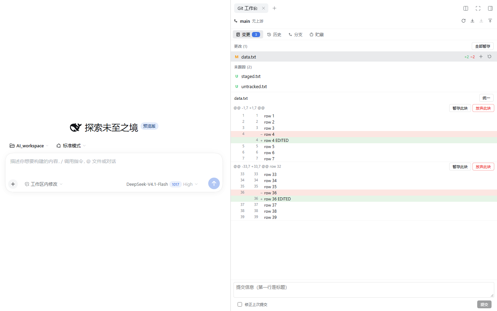
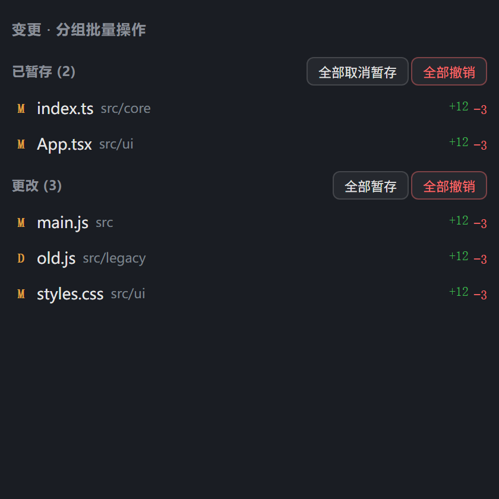
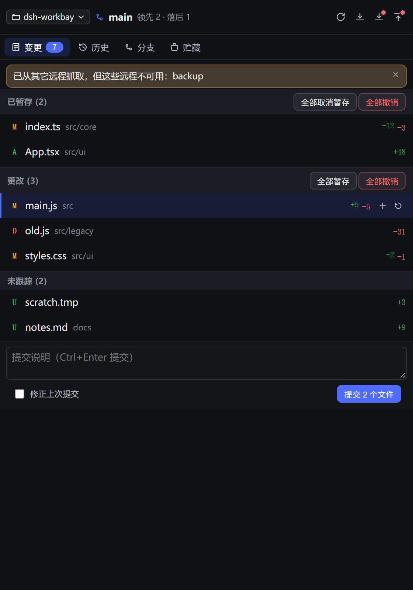
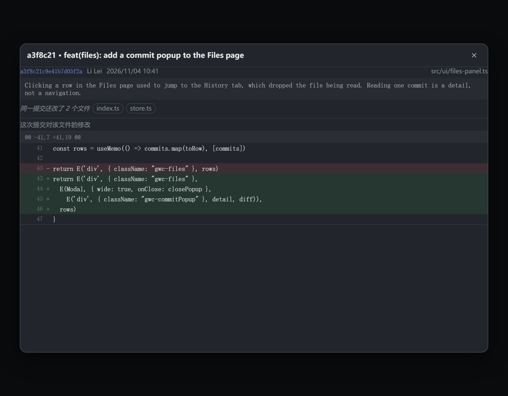
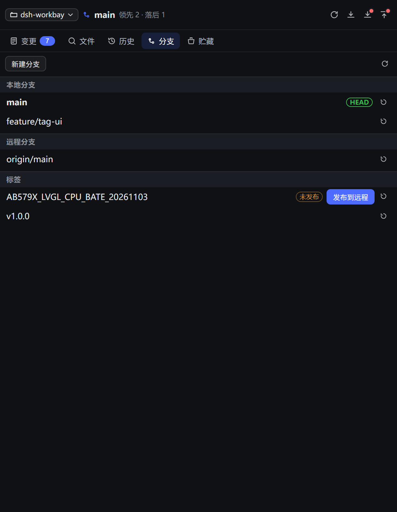
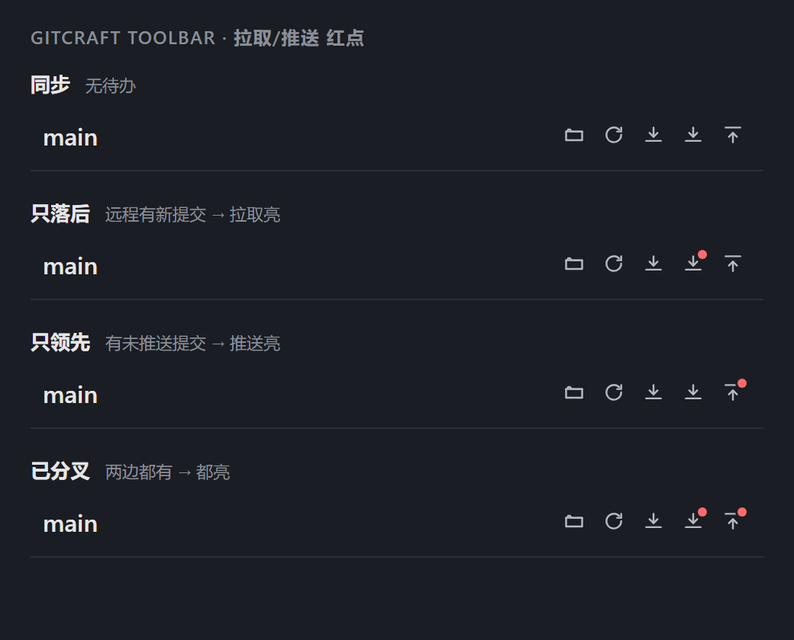

# dsh-gitcraft

> **命名说明**：本插件原名 dsh-git-workbench，但 npm 上已存在同名包（dsh-git-workbench@0.3.4，作者 kaixinbaba），属重名冲突，已更名为 **dsh-gitcraft**（npm 与 GitHub 均无同名）。改名只影响包名、路由前缀与 Tab id，功能不变。


> SourceTree 级 GitCraft，作为 DeepSeek Harness 的侧栏 Tab 运行。自研实现，不包壳、不嵌入任何第三方 GUI。




## 为什么是自研

SourceTree 是 Atlassian 的闭源商业软件（EULA 明确禁止反编译、修改与再分发），无法改造成插件；而现有社区 Git 插件普遍缺少 **hunk 级暂存**、**冲突解决**、**blame / 文件历史 / reflog**。本插件从零实现这四层，并直接挂在 DSH 右侧栏。

## 功能对照

| 能力 | SourceTree | VS Code Git | 本插件 |
|---|---|---|---|
| **hunk 级暂存 / 取消 / 放弃** | ✅ | ✅ | ✅ 逐块按钮 + **行级多选** |
| 逐文件暂存 / 取消 / 丢弃 | ✅ | ✅ | ✅（含批量） |
| **全部暂存 / 全部取消暂存 / 全部撤销** | ✅ | 部分 | ✅ **不拼命令行**，见下节 |
| 提交 / 修正上次提交 | ✅ | ✅ | ✅（`Ctrl/Cmd+Enter`） |
| 分支树（HEAD / 本地 / 远程 / 标签） | ✅ | 部分 | ✅ 含 ahead/behind |
| 分支新建 / 重命名 / 删除 / 设置上游 | ✅ | ✅ | ✅ 受保护分支需二次确认 |
| 合并 + **冲突解决** | ✅ | ✅ | ✅ ours / theirs / 标记已解决 + 继续 / 中止 |
| 变基（含中止 / 继续） | ✅ | ✅ | ✅ |
| Cherry-pick / Revert / Reset（soft·mixed·hard） | ✅ | ✅ | ✅ hard 需显式确认 |
| Stash（创建 / 应用 / 弹出 / 删除 / 清空） | ✅ | ✅ | ✅ 可含未跟踪、可保留暂存区 |
| Fetch / Pull（ff-only 或 rebase）/ Push | ✅ | ✅ | ✅ 独立网络超时，**图标带「有待办」小红点** |
| 标签（轻量 / 附注 / 撤销 / 单个发布） | ✅ | 部分 | ✅ **撤销会同时删远程**，**面板可单个推送**，见下节 |
| 提交图（泳道 + ref 徽章） | ✅ | 扩展 | ✅ 内置，可选紧凑样式 |
| 提交详情 + 逐行 diff（unified / split） | ✅ | ✅ | ✅ |
| **Blame** | ✅ | 扩展 | ✅ 逐行作者/时间/摘要 |
| **文件搜索 + 单文件历史** | ✅ | ✅ | ✅ **跨重命名追溯，带每次的 ±行数** |
| **文件历史**（`--follow`） | ✅ | 扩展 | ✅ |
| **Reflog** | ✅ | 扩展 | ✅ |
| **多仓库 / 选目录** | ✅ | ✅ | ✅ **扫描工作区内全部仓库 + 逐层浏览**，选择记忆在本地 |

## 安装

```powershell
# 本地目录安装（开发/自用）
dsh plugin --profile desktop add 'file:<repo>/packages/gitcraft'
```

装完**重启 DSH**。打开任意会话 → 右侧边栏 `+` → **GitCraft**；或会话头「打开右侧边栏」→ Guide 里的 **GitCraft** 胶囊。

> 面板是「工作台」插件（`dsh-workbay-dock`）的一个页面：打开任意会话 → 左侧栏的 **工作台** 入口 → 面板里的 **GitCraft** 页。**不使用 `dsh-better-sidebar`**，也不会出现在它的 Tab 栏里。


## 选择仓库（不只扫当前目录）

面板不再局限于「会话 cwd 所在的那一个仓库」：

1. 点头部左侧的**仓库胶囊**（显示当前仓库名）打开选择器；
2. **扫描结果**：宿主递归扫描**整个工作区**，列出其中所有 Git 仓库（按工作区相对路径），带分支名与 HEAD 短哈希；
3. **浏览目录**：逐层下钻，仓库用 Git 仓库 标记；落在仓库子目录里时提供「使用仓库根」；
4. 选中后立即切换，并按浏览器记忆（localStorage），下次打开沿用。

扫描边界：跳过 
ode_modules / dist / build / .venv / vendor / target 等噪声目录，深度 ≤6、访问 ≤4000 个目录、结果 ≤200 个；超限会提示改用「浏览目录」逐层查看。选择器只允许工作区内的目录，rowse 与 
epoRoot 都做 realpath 包含检查。

## 与社区项目的关系（独立实现声明）

本插件是**从零独立实现**，没有复制任何社区插件的源码：

- **代码来源**：src/index.js 与 src/client.js 全部为本项目原创（约 1.7k + 2.2k 行）。
- **参考了什么**：只参考了 DSH 的**公开契约**——dsh.bundle.patch 清单格式、webServer.register({kind:'prefix'}) 路由挂载、window.__ModuleLoader__.load({id, factory}) 客户端入口、ctx.betterSidebar.registerTab 与 ctx.sidebarRightTabs.register 两个 seat 的签名。这些是宿主 API，不是某个插件的私有实现。
- **对照过的实现**：dsh-ide-git（KannaKuron，MIT）与 dsh-better-sidebar（omdsh-dev，MIT）被安装/解包后用于核对 API 形状与坑位（例如 ctx.config 在未 inject 的上下文会抛异常、右侧栏 seat 不传 cwd），结论写进了自己的实现里，没有搬运代码。
- **命名**：见上方「命名说明」。取名冲突是我的疏忽，已修正。
## 设计要点

- **补丁由宿主重算**：客户端不发送补丁文本，只发 `path + hunkIndex + lines`，宿主从实时 diff 重新生成补丁再 `git apply --cached`。过期的面板无法应用不匹配的补丁。
- **行级暂存的正确性**：未选中的 `+` 行从补丁中删除；未选中的 `-` 行转成上下文行，并同步重算 `@@` 计数——这是让部分暂存后文件仍保持「已修改」的关键。
- **写操作按仓库串行化**：同一仓库的写请求排队，避免两个标签页同时写 index。
- **trust fence**：路由挂在 DSH 自己的 web server 上，只服务 loopback 或 `Sec-Fetch-Site: same-origin/same-site` 的请求。
- **argv 数组、无 shell**：所有 git 调用走 `spawn(git, argv)`，参数经校验（绝对路径、ref 不以 `-` 开头、路径不含 `..`、不含 NUL）。
- **双 seat 自适应**：面板测量自身容器宽度，在 `columns / stack / compact` 三种 chrome 间切换；主题全部走 `--dsw-alias-*` token。
- **session 回退**：官方右侧栏 seat 只给 `sessionId`，宿主自行解析会话工作区；解析不到时报 `cwd-unavailable` 而不是崩溃。

## 架构

```
src/index.js    host 半：58 个 RPC 方法、git 执行层、补丁生成、写锁、信任围栏
src/client.js    client 半：单文件 React，向工作台注册一个页面，三种布局，i18n(zh/en)
```

Host 暴露 `POST /dsh-gitcraft/api/<method>`，返回 `{ok:true,data}` 或 `{ok:false,error:{code,message}}`。

## 测试

```powershell
# ---- 单元 / 集成（不需要浏览器）----
node --test tests/host.test.mjs           # 51 项：真实仓库端到端（hunk 暂存、冲突、stash、标签发布/撤销、argv 超长、全部撤销、搜索、文件历史、二进制误判、重命名…）
node --test tests/client.test.mjs         # 53 项：加载器契约、工作台页面注册、i18n、TDZ 守卫、rev 守卫、红点渲染、批量按钮、文件页、标签发布、提交弹窗
node --test tests/workspace.test.mjs      # 15 项：工作区扫描、逐层浏览、越界拒绝、深度边界

# ---- 不需要 DSH 的浏览器量测 ----
node tests/toolbar-dot-shot.mjs [exe] [out.png]  # 4 项：红点态 + 按钮不被撑大 + 视觉对照图
node tests/bulk-actions-shot.mjs [exe] [out.png] # 7 项：分组批量按钮同行不换行 + 视觉对照图

# ---- 对运行中的 DSH 打真实路由 ----
node tests/live.e2e.mjs <base> <repo>     # 15 项：全部 RPC 方法 + 护栏

# ---- 真实浏览器（CDP 驱动）----
node tests/ui.e2e.mjs <base> <exe> <repo>        # 10 项：变更列表 + hunk 级暂存
node tests/picker.e2e.mjs <base> <exe> <ws>      #  8 项：仓库选择器（扫描 / 下钻 / 切换）
node tests/history.e2e.mjs <base> <exe> <repo>   #  6 项：历史页签渲染（TDZ 回归）
node tests/rev.e2e.mjs <base> <exe> <repo>       #  5 项：提交内看文件 diff（rev is required 回归）
node tests/coverage.e2e.mjs <base> <exe> <repo>  # 19 项：全 UI 路径覆盖
node tests/diff-layout.e2e.mjs <base> <exe> <repo>  # 15 项：列表/diff 独立滚动 + 拖动分隔条
node tests/watch.e2e.mjs <base> <exe> <repo>       #  4 项：空闲不刷新、改文件自动刷新
node tests/history-inline.e2e.mjs <base> <exe> <repo>  #  9 项：历史页就地 diff、可拖拽、无重复 stat 块
node tests/files-scroll.e2e.mjs <base> <exe> <repo>    #  5 项：「变更文件」列表独立滚动
node tests/detail-split.e2e.mjs <base> <exe> <repo>    #  4 项：提交列表/详情可拖拽
node tests/body-scroll.e2e.mjs <base> <exe> <repo>     #  6 项：长提交日志独立滚动
```

`coverage.e2e` 需要一份特制仓库（进行中的冲突 / stash / 多分支 / 多提交 / 三种工作区状态）：

```powershell
pwsh tests/fixture-coverage.ps1 -Repo D:\tmp\covrepo
```

覆盖路径：变更（暂存/取消暂存/提交框）、历史（搜索/详情/标签弹窗/重置弹窗）、分支（列表/新建/删除确认）、
贮藏（新建/应用/删除）、冲突横幅（继续/中止），以及「全部交互后无错误边界、无 rev 报错、无控制台异常」。

## 批量操作：为什么「全部暂存」曾经报「找不到 git 命令」

**现象**：变更很多（构建产物、生成代码）时点「全部暂存」，弹 `找不到 git 命令`。

**根因不是 git**。旧实现把「全部暂存」展开成**每个文件一个路径**塞进 argv：

```js
// 旧代码（client.js）
doStage(changeGroups.unstaged.concat(changeGroups.untracked).map((e) => e.path))
```

Windows 单条命令行上限约 **32767 字符**，每个路径约 40 字符，所以**约 800 个文件**就爆。
实测（`_repro_argv.mjs` 那种量级）：

| 文件数 | argv 字符数 | 结果 |
|---|---|---|
| 500 | ~26k | 正常 |
| 1500 | ~78k | `spawn ENAMETOOLONG` |

而宿主把所有 spawn 失败**一律**翻译成 `git-missing`：

```js
// 旧代码（index.js）—— 于是「命令行太长」被说成「git 没装」
catch (error) { reject(new PanelError('git-missing', 'cannot start git: ' + messageOf(error), 500)) }
```

**两处都修了**：

1. **前端不再枚举**。批量按钮改成传一个标志：
   `stage {all:true}` → `git add -A`，`unstage {all:true}` → `git reset HEAD --`。
   一条命令、零路径参数，多少文件都不会超。
2. **后端不再撒谎**。spawn 失败按 errno 分类：

   | errno | code | 含义 |
   |---|---|---|
   | `ENOENT` | `git-missing` | git 真的不在 PATH |
   | `ENAMETOOLONG` | `argv-too-long` | 路径列表太长，请改用批量操作 |
   | 其他 | `git-spawn-failed` | 其他启动失败 |

   只有第一种才是「装 git」能解决的。测试里有一条断言**直接验证旧写法返回 `argv-too-long` 而不是 `git-missing`**。

### 全部撤销

变更分组头右侧新增「全部撤销」（红色，两组都有 —— 暂存与否和工作区要不要丢弃无关）：

```
已暂存 (2)                        [全部取消暂存] [全部撤销]
更改 (3)                          [全部暂存]     [全部撤销]
```

确认弹窗写清代价：已暂存 + 未暂存的改动全部丢弃、未跟踪文件删除。
实现上分两步：`git restore --source=HEAD --staged --worktree -- .` 复原所有已跟踪文件，
再 `git clean -d --force` 删未跟踪。

> **`--force` 但没有 `-x`**：`.gitignore` 忽略的构建产物**故意留着**。
> 用户说「撤销更改」时，通常不想连 build 目录一起删掉 —— 那不是他手写的改动。
> 这条有独立测试（`discard all keeps ignored build output`）。



## 性能：每个请求少一次 git spawn

这台机器上**单次 git 调用约 90–115 ms**（冷启动的 Windows 用户配置，用 `tests/bench.mjs` 测）。所以"快不快"几乎完全等于"一个请求里有几次 spawn"。

**改前**：`repoRootOf()` 对每个请求都跑一次 `git rev-parse --show-toplevel`，即使客户端发来的 `repoRoot` 已经是解析好的路径 —— 每个请求都白付一次 spawn。

**改后**（同机同仓，1500 文件 / 180 变更）：

| 端点 | 改前 p50 | 改后 p50 |
|---|---|---|
| `snapshot` | 113 ms | **2.9 ms** |
| `status` | 149 ms | **3.5 ms** |
| `log`（首屏） | 220 ms | **4.1 ms** |
| `branches` | 222 ms | **3.8 ms** |

两处缓存都**按 watcher revision 做代际**，不是按时间：

- `rootCache`：`目录 → 仓库根`，TTL 30 s。**否定结果也缓存**（3 s），否则仓库选择器逐个探非仓库目录时每次都要 spawn，浏览像卡死。`init` 会显式清空它。
- `listCache`：提交列表 / 分支列表，key 里带 `watcherRevisionOf(root)`。文件一变 watcher 就 `revision += 1`，旧 key 自然不可达 —— **不需要任何"记得调用失效"的代码**。写操作仍显式 `invalidateLists()`，因为 `commit` 写 `.git/` 时 watcher 事件可能还没到。调用方没有跑 `/watch`（例如源码管理页）时可传 `refresh: true` 强制跳过缓存，否则 watcher revision 永远是 0，外部提交后刷新也会读到旧列表。

> p95 仍偏高（`log` 318 ms）是**进程内第一次**读取的代价；缓存命中后才是 p50 的 4 ms。首屏避不开一次 spawn，这是 git 的物理下限。

### 历史详情与 diff：一个进程 + 命中缓存

查看提交详情原来要跑两次 `git show`（一次 `-s` 取说明，一次 `--name-status` 取文件）。
在同样的 Windows 机器上，单次 spawn 约 90–250 ms，所以这一跳经常是 400 ms 以上。
现在合并成**一条** `git show --name-status -z --pretty=format:…%x1e`：说明和文件列表从同一流里解析。

提交哈希是不可变内容，因此 `commitDetail` 增加了 200 条 LRU 缓存和同请求合并；重复点同一提交
（以及悬停预取）不再起 git。实测同一仓库（demo，100 条历史）：

| 操作 | 改前 | 改后（冷） | 改后（缓存命中） |
|---|---|---|---|
| 提交详情 | 378–422 ms | **97 ms** | **3 ms** |
| 提交 diff | 295 ms | **119 ms** | **3 ms** |

源码管理页在悬停提交行/变更行时会提前发 `commitDetail` / `diff` 请求（140–160 ms 防抖），
用户真正点击时通常已经是 diff 缓存命中。日志本身仍按 `limit` 分页，不拉 `--numstat`。

## 「有时候获取时报错」的真因

不是网络不稳，也不是随机故障。`git fetch --all` 是**全有或全无**的：只要有一个远程失败（离线镜像、写错的 URL、已删除的备用远程），git 就返回非零 —— 即使 origin 已经成功抓完。面板把整次 fetch 报成失败，把成功的结果也丢了。

复现很简单：加第二个不存在的远程后 `git fetch --all` 立刻 exit 1，而 `git fetch origin` 仍然 exit 0。

现在**逐个远程 fetch**：成功几个算几个，失败作为 `partial` 数据返回，UI 显示一条**黄色警告**而不是红色错误。

| 情况 | 现在的行为 |
|---|---|
| 全部成功 | 正常提示 |
| 部分远程失败 | 黄色警告：`已从其它远程抓取，但这些远程不可用：xxx` |
| 全部失败 | 报错（这确实是真的失败） |
| 仓库没有任何远程 | `no-remote`，明确说清 |

## 界面细节



本轮修的几个「木讷」：

1. **消息不再遮挡控件**。提示条原来是 `position:absolute`，但 `.gwc-root` 没有定位上下文，于是它相对整个页面定位 —— 钉在底部时正好压住「提交」按钮，一次抓取警告就能把主操作挡住。现在它是 nav 与 body 之间的**正常布局行**，出现时把内容往下推，永远不盖任何东西；点击可关闭。
2. **首屏骨架**。加载时原来只有一行灰字，内容到达时面板会跳一下。现在是带 shimmer 的骨架行（`prefers-reduced-motion` 下不闪），面板保持形状。
3. **空态不再是死路**。没有变更时显示图标 + 说明 + 当前可用的动作（刷新 / 拉取 / 推送），并区分「干净且已同步」和「干净但没同步」。
4. **行密度与选中态**。行高 24→26px；选中行加左侧强调条，而不是整块反白（3 行的列表原来看起来像一整块色块）。
5. **分组分隔**。每组标题带上分隔线（首组除外），层级一眼能分。
6. **警告用黄色，不用红色**。部分远程失败这类「做成了但有事要说」的消息不再伪装成错误。

## 文件页：搜索文件 + 查看单个文件的修改历史


之前**这个功能等于不存在**：后端 `fileHistory` / `blame` 早就写好了，但客户端一次都没调用过
（`blame` 的 state 声明了却从未被 set）。工作区干净时，面板里没有任何入口能问
「这个文件是什么时候被谁改的」。

新增 **文件** 页签（`nav.files`）：

- **按文件名搜**（`git ls-files`）：支持目录片段（`src/core` 能搜到里面的文件），
  大小写不敏感可切换，**basename 命中排在前面** ——「index」应该先给 `index.ts`，而不是
  `src/index-helpers/readme.txt`。
- **按内容搜**（`git grep -n -I`）：给出行号与整行文本，`-I` 跳过二进制。
- 输入 **220ms 防抖**：每次搜索是一次 git spawn（~100ms），逐键搜索会堆积，而且会先返回
  你已经敲过去的那个前缀的结果。**过期响应会被丢弃**（比对 query）。
- 点结果行 → 右侧列出**该文件的提交历史**；行可键盘操作（`role=button` + `Enter`）。

每行显示：短哈希、提交说明、作者、时间、以及**这次提交对该文件自己的 `+N −M`**。

### 两个坑（都是 git 的真实限制，不是 bug）

**1. `--follow` 不能和 `--numstat` 一起用。** 一起用 git 会**静默放弃** follow 行为，
只返回重命名之后的提交 —— 而那正是这个功能要解决的问题。所以取两次：

```
git log --follow --pretty=format:... -- <newPath>      # 拿到提交集合（跨重命名）
git log --numstat --format=%H --no-walk=unsorted <hashes...>   # 拿到每次的增删数
```

**2. numstat 必须按路径过滤，但要按「当时那个名字」过滤。** 这一条来回错了两版：

- 第一版**不**过滤，把整块 numstat 当作这个文件的改动。错了 —— 一个提交同时改了源码和字体/图片时，
  二进制兄弟文件的 `-\t-` 会把**纯文本的源码文件**标成「二进制」，行数也全没累加。
  这就是「为什么记录中显示二进制文件呢，应该是有修改记录的」那个 bug。
- 第二版按调用方传的**新路径**过滤。也错了 —— 重命名之前的提交里路径是**旧名字**，全被滤掉。
- **现在的做法**：先从 numstat 自身反推出这个文件用过的**所有名字**
  （`pathsOfFileInHistory`，顺着 `old => new` 往回走），再按这个集合过滤。

```
0	0	src/{old => new}/keep.md     ← 大括号形式：只有目录改名
2	1	src/main.c                   ← 普通行
-	-	font.ttf                     ← 二进制，必须【不】影响上面两行
```

> **大括号形式**是个隐藏的坑：`src/{old => new}/keep.md` 用 `split('=>')` 会切成
> `src/{old` 和 `new}/keep.md`，两个都不是真实路径，过滤就匹配不到 —— 结果所有行数
> 静默变成 0，看起来像「没改过」。`expandRename()` 专门重建这两种完整路径。

> 还有个连带的边界：用 `<最旧提交>^..<最新>` 做范围时，如果最旧的是**根提交**（没有父），
> git 直接报 `ambiguous argument`。年轻仓库必然踩到。改用 `--no-walk` 按 hash 列举，
> 既不依赖父提交，也不会意外扩大范围。

### 点开某次提交：弹窗，不跳页



在文件页点一条提交记录，**原地弹出**这次提交对该文件做了什么：

- 顶部一行元信息：短哈希、作者、时间、当前文件路径；
- 提交正文（没有正文时**不显示**，不会把标题重复一遍）；
- 同一提交还改了哪些文件（胶囊标签，最多列 12 个）—— 免得你以为改动只来自这一个文件；
- 下面是**这个文件在该提交的 diff**，占满剩余高度。

之前这里是 `setNav('history')`：点一下就跳走了，正在看的文件、搜索词全丢。
**读一次提交是细节，不是导航**，所以改成弹窗。

实现只用两个已有接口：`commitDetail`（元信息）+ `diff({base:'commit', rev})`（本文件的 diff）。
提交里没碰这个文件时是**空 diff 而不是报错**；二进制文件直接标记，不去尝试 diff。

> 顺带修了一个渲染 bug：`%B` 是 pretty format 的**最后一个字段**，而格式串以 `%x1e` 结尾，
> 于是记录分隔符粘在了正文末尾 —— 弹窗里会显示一个看不见的控制字符，并且
> 「正文等于标题」的判断失效，导致**无正文的提交把标题打印两遍**。
> 现在 `cleanCommitBody()` 同时负责去分隔符、去标题前缀、去尾部空行。

## 推送标签



`git push` **默认不会推送标签**，必须显式指定。以前面板里只有「撤销」，没有「发布」，
所以推送标签只能走命令行。

「分支」页现在会标出**哪些标签还没上去**，并在那一行直接给一个「发布到远程」按钮：

| 状态 | 显示 |
|---|---|
| 所有远程都有 | 无标记，无按钮 |
| 一个都没有 | 黄色 `未发布` + 「发布到远程」 |
| 缺部分远程 | 黄色 `缺 N 个远程` + 「发布到远程」 |

命令行等价：

```bash
git push origin release-demo
# 或显式写全引用，避免与同名分支歧义：
git push origin refs/tags/release-demo
```

### 为什么必须问远程

分支有 `refs/remotes/origin/x` 这样的本地跟踪引用，**标签没有** —— `git fetch` 把标签
直接写进 `refs/tags/`。所以「这个标签推上去了吗」本地无从判断，只有 `ls-remote` 能回答。

实现上：

- **一次 `ls-remote --tags` 拿全部标签**，不是每个标签问一次。40 个发布标签逐个问会是 40 次 spawn。
- 只在**切到分支页时**加载，不参与轮询 —— 否则每次快照都会打一次网络。
- 状态未知时（`published: null`）**不渲染「未发布」**，否则首帧所有标签都会闪一下发布按钮。
- 不提供「推送全部标签」的批量按钮：`git push --tags` 会把构建留下的临时标签一起扫上去，
  这正是很多人被坑过的地方。要批量请用命令行 `--tags`，面板只做单个。


## 撤销标签

标签只是一个 ref，所以**撤销标签永远不会改写提交**。在「分支」页的标签行点 ⟲：

```
分支 / 标签
  HEAD  main
  本地  main            ↑2        ← 2 个未推送提交
  远程  origin/main
  标签  v1.0.0
        v1.0.1        [签出] [⟲ 撤销]   ← 点这里
```

弹窗里只有一个勾选：

| 勾选「同时删除远程标签」 | 结果 | 什么时候用 |
|---|---|---|
| ✅ 默认 | `git tag -d v1.0.1` + `git push --delete origin refs/tags/v1.0.1` | 标签**打错了 / 已经推上去想撤回** |
| ⬜ | 只 `git tag -d v1.0.1` | 远程那条要留着，只手滑删了本地 |

**为什么默认勾上**：标签和分支不一样，`git fetch` 会把远程标签直接写进 `refs/tags/`。
所以只删本地、远程还留着的话，**下一次抓取就又回来了** —— 看起来像「删不掉」。
`host.test.mjs` 里专门有一条测试走完这个循环来钉死这个行为。

想反过来（本地建好了、要发到远程），用 `tagPush`：**只推这一个标签**，
不会像 `git push --tags` 那样把一堆临时标签一起扫上去。

命令行等价操作：

```bash
git tag -d v1.0.1                          # 本地
git push --delete origin refs/tags/v1.0.1  # 远程
```

## 拉取 / 推送图标上的小红点

头部三个网络按钮，后两个会带一个 6px 红点，表示**这个方向还有活没干完**：

| 图标 | 红点条件 | 含义 | 等价命令 |
|---|---|---|---|
| ⬇ 抓取 | 从不 | 只是同步 ref，没有「待办」概念 | `git fetch --all --prune` |
| ⬇ 拉取 | `behind > 0` 且有上游 | **远程有你没有的提交**，该拉了 | `git pull --ff-only` |
| ⬆ 推送 | `ahead > 0` 且非游离 HEAD | **你有远程没有的提交**，该推了 | `git push` |

两边都有（分叉）时**两个点同时亮**，提请你先拉再推。



细节：

- 两个点是**独立来源**的（`behind` / `ahead`），不是一个「有差异」的总灯 —— 那等于什么都没告诉用户；
- 红点跟随按钮自己的 `disabled` 条件：游离 HEAD 下推送不可用，所以**不亮**——亮一个点不了的按钮是骗人；
- 红点是 `position:absolute` 的 6px 圆点，**完全不参与布局**，按钮始终 24×24、整行始终 128px 宽。
  这一点有实测守卫（`tests/toolbar-dot-shot.mjs`）：它测四种状态下的按钮盒子，尺寸必须一模一样。
  这和工作台入口那个「28px 撑歪整个侧栏」是同一类坑，别再踩。

## 历史页：就地查看 diff，不再跳走

点提交里的文件，diff **在历史页下方展开**，不再切换「变更」标签页：

```
┌───────────────────────────────┐
│ 搜索提交信息…                  │
│ ● fix: tweak two files   main │  ← 提交列表
│ ● feat: seed three files      │
│ fix: tweak two files          │
│ 560f426 Li Lei 2026/10/30     │
│ [优选到当前分支] [还原] [重置…] │
│ 变更文件 (2)                   │
│   M a.c                       │
│   M b.c                       │
├════════ 拖动调整高度 ══════════┤
│ a.c                  [统一] ✕ │  ← 就地 diff（可关闭）
│ @@ -2,7 +2,7 @@               │
│ - a line 5                    │
│ + a line 5 EDITED             │
└───────────────────────────────┘
```

- **提交正文（日志）限高 + 独立滚动**：正文最长占详情区的 44%，再长就在框内滚，
  「变更文件」不会被长日志顶出视野；
- **「变更文件」列表有自己的滚动条**：滚动它不会把提交标题、作者、操作按钮顶出视野；
- **提交列表与提交详情之间也有一条分隔条**：拖动即可决定详情区多大（默认列表 34%）；
- **提交列表也有自己的滚动条**；
- 外层区域本身不再整体滚动（实测 `mainScrollable: false`）；
- 该区域与下方 diff 之间**有分隔条，可拖动拉大拉小**（默认 55% / 45%，实测拖 120px
  后上方 370→289、diff 249→330）；
- diff 表头 sticky，带「统一/分栏」切换和关闭按钮；
- 切到别的提交时，上一个文件的 diff 自动收起。

> 之前点文件会 `setNav('changes')` 跳到变更页，既丢了正在读的提交，也把两个视图混在一起。

同时去掉了两处重复内容：

- **提交的 `git show --stat` 摘要块** —— 它和下面的「变更文件 (n)」列表是同一批文件，
  而且每次都要多跑一次 `git show`（这台机器约 1.5 秒）。宿主端也一并删掉了那次调用。
- **提交正文框** —— `%B` 自带标题行，没有正文的提交会把标题重复显示一遍。


点提交里的文件，diff **在历史页下方展开**，不再切换「变更」标签页：

```
┌───────────────────────────────┐
│ 搜索提交信息…                  │
│ ● fix: tweak two files   main │  ← 提交列表
│ ● feat: seed three files      │
├───────────────────────────────┤
│ fix: tweak two files          │
│ 560f426 Li Lei 2026/10/30     │
│ [优选到当前分支] [还原] [重置…] │
│ 变更文件 (2)                   │
│   M a.c                       │
│   M b.c                       │
├───────────────────────────────┤
│ a.c                  [统一] ✕ │  ← 就地 diff（可关闭）
│ @@ -2,7 +2,7 @@               │
│ - a line 5                    │
│ + a line 5 EDITED             │
└───────────────────────────────┘
```

> 之前点文件会 `setNav('changes')` 跳到变更页，既丢了正在读的提交，也把两个视图混在一起。

同时去掉了两处重复内容：

- **提交的 `git show --stat` 摘要块** —— 它和下面的「变更文件 (n)」列表是同一批文件，
  而且每次都要多跑一次 `git show`（这台机器约 1.5 秒）。宿主端也一并删掉了那次调用。
- **提交正文框** —— `%B` 自带标题行，没有正文的提交会把标题重复显示一遍。

## 刷新：文件变了才刷新，不再定时轮询

之前面板是**每 15 秒无条件全量刷新**——所以「正在读取差异…」会周期性闪一下，
仓库明明没动也在反复读快照和 diff。

现在改为**事件驱动**：

```
宿主：fs.watch(repoRoot, { recursive: true })  →  维护一个递增的 revision
客户端：POST /api/watch { since }              →  长轮询，最多挂 12 秒
         revision 变了 → 立即返回 changed:true → 刷新快照与 diff
         revision 没变 → 挂到超时才返回        → 一次重活都不干
```

- 空闲仓库：**没有任何重请求**，也不会有加载闪烁；
- 真实改动：通常 **1 秒内**自动出现，无需手动刷新；
- 忽略噪声：`.git/objects`、`.git/logs`、`.git/lfs`、`node_modules`、`*.lock` 的变化不触发刷新；
- 文件系统不支持递归 watch 时，宿主返回 `supported: false`，客户端退回 5 秒慢轮询；
- 面板不可见时循环停止；卸载时用 `AbortController` **主动中止**挂起的请求，不占用浏览器连接。

另外，重新加载同一个文件的 diff 时**不再清空已有内容**，所以不会闪空白。

> 踩过的坑：最初的实现让 effect 依赖 `store`（每次渲染都是新对象），于是每次渲染都重启循环、
> 再发一个长轮询。浏览器同源只允许 6 个连接，挂起的请求很快占满连接池，`snapshot` / `diff`
> 全部排队——面板显示空列表。现在依赖稳定的 `store.refresh`，并在清理时 abort。

### 一个环境事实：这台机器上单次 git 调用约 1.5–1.9 秒

所以「一次刷新要起几个 git 进程」直接决定面板手感。快照原先要 **9 个**进程
（`rev-parse HEAD`、`symbolic-ref`、`rev-parse @{upstream}` + `rev-list`、`status`、
两次 `--numstat`、`rev-parse --git-dir`、`diff --diff-filter=U`），现在只剩 **3 个**：
一次 `git status --porcelain=v2 --branch`（HEAD / 分支 / 上游 / ahead-behind / 冲突全在里面）、
两次 `--numstat`。`gitDir` 和「进行中的操作」直接从 `.git` 读文件得出，不再 spawn。
外面再包一层 400ms 快照缓存 + 同请求合并：`snapshot` / `status` 并发时只跑一次，
任何写操作（以及任意一次非读调用）都会在 `finally` 里清掉缓存，缓存不会掩盖外部改动。

本机小仓库实测：

| 场景 | 改前 | 改后 |
|---|---|---|
| 连续 10 次快照（轮询 + UI 调用） | 479 ms / 10 个 git 进程每次 | 134 ms / 约 1.6 个 |
| 缓存过期后的冷读 6 次 | 458 ms / 10 个 | 261 ms / 4 个 |

3 个进程彼此并行，剩下的成本主要是 git 进程启动本身。
路径实时校验（`verifyPath`）仍是 1 次 git 调用，校验期间按钮显示「正在检查…」。

## 变更/历史视图：diff 用居中大弹窗

在「变更」或「历史」页点击文件，diff 都以**居中弹窗**打开（宽 `min(1100px, 92vw)`、高
`min(70vh, 720px)`），文件列表保持占满整页：

```
┌────────────────────────────┐
│ 更改 (30)      全部暂存     │  ← 文件列表（占满）
│ M file1.txt          +1 −1 │
│ M file10.txt         +1 −1 │
├────────────────────────────┤
│ 提交信息…            [提交] │
└────────────────────────────┘

点击文件 ↓

        ┌───────────────────────────────┐
        │ dir1/file1.txt      [统一] [关闭] │
        │ @@ -12,7 +12,7 @@               │
        │ - line 15 of file 1             │
        │ + LINE 15 EDITED of file 1      │
        └───────────────────────────────┘
```

- 弹窗内 diff 独立滚动，表头 sticky；`Esc`、点遮罩或「关闭」退出；
- 暂存/丢弃 hunk、行选择等操作在弹窗里照常可用；
- 变更页和历史页共用同一个弹窗组件；历史页不再把列表压成分栏。
## 性能与构建期行为

- 快照用 `git status --untracked-files=normal --no-renames`：构建产生的几万个未跟踪产物
  只会折叠成目录行（不再逐个扫描），重命名检测也跳过；实测 4 万产物时 status 快 2.6×。
- 文件变更做 **300ms 去抖**；快照在途时**不取消**它，只在完成后补一次刷新。构建持续写
  文件时首屏也能完成（旧逻辑每个文件事件都重启快照，于是一直停在“正在读取”）。
- 页面加载超过 2 秒会提示“构建进行中或仓库较大”；超过 20 秒会中止并给出可重试的错误，
  不会无限停在“正在读取仓库…”。

## 已知限制

- 交互式变基（`rebase -i`）、三方合并编辑器、submodule / LFS 管理尚未实现（冲突可用 ours/theirs/标记解决 + 继续，或去终端）。
- 刷新靠 `/watch` 长轮询（文件系统不支持递归监听时退回慢轮询）+ 操作后立即刷新；快照带 400ms 缓存。
- 外部进程只改 ref、且不改变快照任何字段时（例如在终端里 `git tag v1`），历史页与分支列表要等下一次 HEAD 变化或手动点「刷新」。这是快照形状的边界，不是漏了监听。
- 分发方式是 GitHub 源码 + `file:` 安装，不发布 npm 包。

## License

MIT
