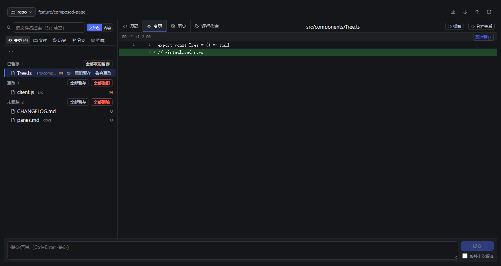
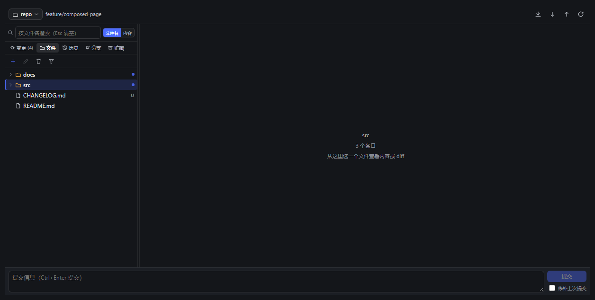
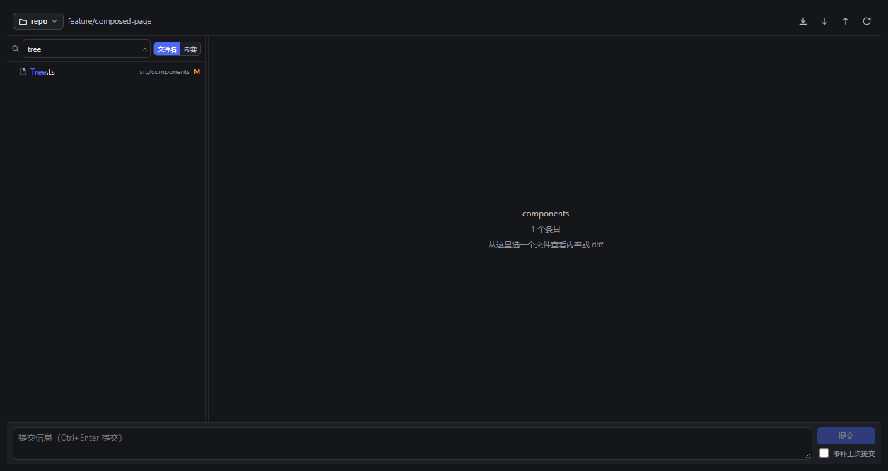
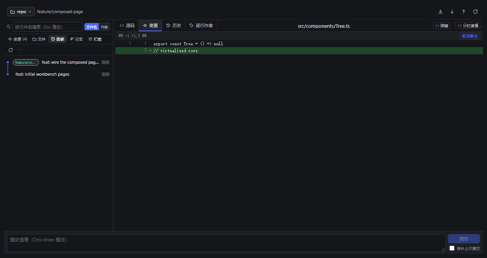
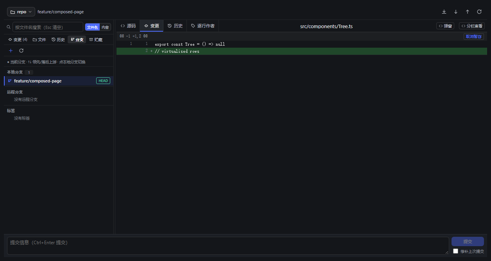

# dsh-workbay-source-control

> 工作台的**源码管理页**：**一棵**带 Git 状态的树，右边是文件或它的 diff，底部是提交框。
> 把以前要在「文件」和「GitCraft」两个页之间来回切的动作（看变更 → 看 diff → 改代码 → 提交）
> 收到一屏里。不使用 `dsh-better-sidebar`。

| 模式 | 截图 |
|---|---|
| 变更（分组） |  |
| 文件 + diff |  |
| 搜索 |  |
| 历史 |  |
| 分支 |  |

截图由 `tests/shots.mjs` 生成（真浏览器 + 真 git 仓库），改了 UI 就重跑一遍。

---

## 为什么不是「把两个页面塞进一个壳」

评估阶段做过三种粒度的取舍，结论写在这里免得后人重走：

| 方案 | 工作量 | 为什么不行 |
|---|---|---|
| 客户端合流（两个 `client.js` 合成一个） | 31–48 人日 | 编辑器 chunk 变成跨包硬依赖（+437 KiB gzip 或打破独立安装） |
| 连 host 一起合并 | 41–64 人日 | 72 个 RPC 合表、两套 config、per-repo 写锁分级，还要丢掉独立发版 |
| **本方案：壳 + panes 契约** | **约 20 人日** | — |

关键判断：**两个页面在「能力」上几乎不重叠**（diff 渲染只在 gitcraft，编辑器只在 files），
重叠的是基础设施。所以收益不是「少写代码」，而是**一屏内完成提交**。

---

## 它自己不做的事

**本页不拥有任何数据路由。** 树来自 `/dsh-workbay-files/api/tree`，Git 状态来自
`/dsh-gitcraft/api/snapshot`，写操作走同一套 git RPC。理由：

- 重写一份文件 API 等于重写 `resolveInside` 的 realpath 围栏，**第一个 bug 就是沙箱逃逸**；
- 重写一份 git RPC 等于重写 per-repo 写锁；
- 复用两个已有的 host，同源围栏、限长 body、错误信封全部继承。

host 半侧（`src/index.js`）因此只有一件事：一个诊断端点，回答「我的两个依赖挂上了吗」。
页面依赖的是**另外两个插件**，而「缺一个」是最可能的安装错误——能问出原因比猜强。

---

## 它自己做什么

### 左栏五个模式，一列

这一页要替掉「文件」和「GitCraft」两个页，所以左栏不是一棵树加一列变更，而是**五个模式**——
它们正好覆盖一个人从源码管理里要的五件事：

| 模式 | 作用 | 原来在哪 |
|---|---|---|
| **变更** | 我改了什么（按类型分组） | GitCraft 的变更页 |
| **文件** | 东西在哪（含搜索） | 文件页 + 它的搜索 |
| **历史** | 发生过什么 | GitCraft 的日志 |
| **分支** | 我能去哪 | GitCraft 的分支 |
| **贮藏** | 我暂存了什么 | GitCraft 的贮藏 |

**一列、一个滚动条、一个选中项**——任何时候都不出现两份并排的列表，这是这个页面存在的理由。

模式按需加载：日志是一次 `git log`、分支是一次 `for-each-ref`、贮藏是一次 `stash list`。
打开页面就全取会让「只想看 diff」的人多付三个子进程，所以各自首次切过去才加载。

贮藏时会先选择范围：

- **仅暂存区**：`git stash push --staged`，只收走已暂存改动，未暂存/未跟踪文件留在工作区；
- **全部更改**：`git stash push --include-untracked`，收走已暂存、未暂存和未跟踪文件。

同一文件同时有已暂存和未暂存改动时，git 无法只贮藏其中一半，页面会禁用「仅暂存区」并提示先选「全部更改」或处理该文件。

点击任意贮藏条目会在右侧打开贮藏详情：提交说明、文件列表、应用/弹出/删除，以及
「查看全部差异」；点单个文件查看该文件在贮藏中的 diff。详情使用 `stash@{n}` 作为
revision，不依赖提交历史列表。

### 搜索：文件名和内容两种模式

搜索框在树上方，**结果替换掉树**而不是并排显示——「找一个文件」和「浏览到一个文件」是同一件事。

- **文件名**：模糊匹配路径，命中字符高亮（宿主返回 `indices`，这里只按目录前缀偏移后上色，
  不重新算一遍谁匹配了，避免两处对「匹配」有不同意见）
- **内容**：在文件内容里搜，按文件分组 + 行号 + 命中行文本
- **220ms 防抖**，并用序号取消：慢的旧查询不会覆盖快的新查询
- **Esc 清空**并回到浏览——搜索框是页面里最内层的作用域，它先拿键

### 变更按类型分组，可折叠

| 组 | 内容 |
|---|---|
| **冲突** | 先解决，别的都做不了 |
| **修改** | 内容/类型变化的文件（含已暂存与未暂存） |
| **删除** | 从工作区消失的文件；点击直接看删除 diff |
| **新增** | 新加入 git 或尚未跟踪的文件 |
| **重命名** | git 识别为 rename 的文件 |

默认全部展开；点组头或按 Enter/Space 收起/展开，组头显示数量。
冲突文件的 diff 会把 git 的 combined `diff --cc` 转成可解析的统一 diff：工作区（包含
`<<<<<<< / ======= / >>>>>>>` 冲突标记）对 `--ours` 阶段显示，不再出现「没有差异」。
每个类型组内部再按 **已暂存 / 未暂存** 分成两个小节（带数量），已暂存行排前面；
即使一个类型组只有一种状态，也会明确标出。每一行仍有 `暂存/取消暂存`、`丢弃` 动作。

批量动作按组内实际行计算：只有组里有未暂存行才出现「全部暂存」，只有组里有已暂存行
才出现「全部取消暂存」；丢弃只作用于未暂存/未跟踪行，整组都是未跟踪文件时文案用「删除」。

「历史」里点一个提交，右侧显示**这次改了哪些文件**（含提交说明正文）。
不显示 patch 是刻意的：那需要 diff 面板接受 revision，是另一个契约；
先看到「改了哪些文件」才是读提交时的第一个问题。

### 历史搜索

历史工具栏的放大镜按钮打开搜索行，可选择 **全部 / 哈希 / 说明 / 作者** 四种字段：

- 哈希支持完整哈希或短哈希前缀；
- 说明搜索提交主题，作者搜索姓名或邮箱；
- 大小写不敏感，显示匹配数量；Esc 先清空查询，再关闭搜索行；
- 搜索范围是**当前已加载的提交**；没有匹配时仍可点「加载更多提交」扩大范围。

### 刷新历史 / 分支不会拿到旧缓存

源码管理页不跑 gitcraft 的 `/watch` 长轮询，所以 gitcraft 按 watcher revision
做的列表缓存（`log` / `branches`）在外部提交、`git pull`、页面重载后可能仍是旧代际。
这里每次加载历史/分支都带 `refresh: true` 绕过该缓存；右上角刷新也走同一路径。
e2e 会在外部 `git commit` 后点刷新，断言新提交出现。

### 一棵树，不是两棵

「文件」模式里变更**不是**第二棵树，而是同一棵树上的徽章 + 目录圆点：

- 目录在前、文件在后，自然序（`file2` 在 `file10` 之前）
- **每个文件最多一枚单字母徽章**：`M` 修改 / `A` 新增 / `D` 删除 / `R` 重命名 / `T` 类型变更 / `C` 冲突 / `U` 未跟踪
- **目录只显示一个 6px 圆点**，不显示字母
- `+N −M` 只在有变更的行上出现，干净文件**什么都不显示**（不留空槽）

### 两个内容槽，都不卸载

「源码 / 变更」是页内页签，两个面板**都保持挂载**，只切 `hidden`。
好处是切页签是瞬时的，而且切走时编辑器的未保存内容不会丢。

### 四个断点，任何宽度都不加第三栏

按**本元素的宽度**（`ResizeObserver`）判定，不看视口——工作台可以是 360px 的停靠列，
也可以是 1400px 的浮窗。

| 档 | 宽度 | 树 | diff |
|---|---|---|---|
| XS | < 480 | 100%，选中后内容区推入 | unified |
| S | 480–719 | 200–260 | unified |
| M | 720–1023 | 240–300 | split |
| L | ≥ 1024 | 280 固定（可拖 240–360） | split |

宽屏多出来的空间给 split diff，**不给第二份列表**。

### 三件容易被忽视的正确性

**1. 两个 host 对「路径相对谁」的定义不同。**
文件 host 的路径相对**工作区根**，git host 相对**仓库根**。单仓库时两者相同；
工作区里有多个仓库时不同（`repo-a/src/x.ts` vs `src/x.ts`）。
不换算的话，每个文件都会显示成「干净」——**静默错误**。换算在 `repoRootRelative` /
`toRepoPath` / `toWorkspaceRel` 三个纯函数里，且有单测覆盖往返。

**2. 丢弃更改会把未保存的内容写回去。**
编辑器里有未保存改动时点「丢弃」：磁盘回到 HEAD，但内存 buffer 还在，下一次保存就把
「丢弃掉的」内容写回去了。所以 `requestDiscard` 先问 `commands.hasDirty`，确认后
还会让编辑器重新读盘。

**3. 窗口隐藏时什么都不轮询。**
最小化之后看不到快照，而一次 git 快照是**三个子进程**。页面读 `document.visibilityState`，
隐藏时挂起。

---

## 文件树右键菜单（替代行内 `@`）

文件树、变更列表的每一行都支持**右键菜单**（行内悬浮的 `@` 按钮已移除）：

| 菜单项 | 行为 |
|---|---|
| 加入对话 | 把该文件的**绝对路径**（目录则带尾 `\`）以纯文本插入会话输入框，末尾留空格；不带 `@` |
| 复制绝对路径 / 复制相对路径 | 写入剪贴板，状态栏回显 |
| 打开文件所在目录 | 调 host 新增的 `files.reveal`（Windows `explorer.exe /select,`；目录则直接打开） |
| 在编辑器中打开 | 选中文件并按 `变更/源文件` 切到对应视图（仅文件） |
| 新建文件 / 新建文件夹 | 在该目录下创建（仅目录行） |
| 重命名 | 文件/目录都支持，路径冲突由 host 返回 409 |
| 删除 | 删除文件；**目录会带 `recursive:true`**，确认框明确提示会删除全部内容 |
| 添加忽略 | 在仓库根 `.gitignore` 写入以 `/` 锚定的路径；若该路径已被跟踪，同时 `git rm --cached`（工作区文件保留），提交这次删除后生效；历史提交不重写。目录会写成 `/dir/` 并递归停止跟踪 |
| 刷新 | 重新加载该目录、git 快照和已打开的历史/分支（绕过列表缓存） |

绝对路径由 `absoluteFromRoot(browseRoot, rel)` 生成（仓库在工作区外时用仓库根），
兼容盘符根与 UNC 路径；`fileOp` 现在接受右键目标，不再依赖“当前选中项”。
`reveal` 走与其它文件接口相同的 root 围栏（越界路径 403，有 host 测试）。

## 分支页右键菜单与远程地址

分支（本地/远程/标签）、远程分组标题都支持右键菜单：

| 行类型 | 菜单 |
|---|---|
| 本地分支 | 签出、合并、变基、推送、重命名、设置上游、复制名称、在浏览器打开、删除 |
| 远程分支 | 签出为本地分支、合并、变基、复制名称、在浏览器打开、删除远程分支 |
| 标签 | 推送标签、复制名称、在浏览器打开、删除本地/远程标签 |
| 远程分组（如 `origin`） | 复制远程地址、在浏览器打开仓库、获取此远程 |

**远程地址**来自 gitcraft 的 `repoInfo`（`git remote -v`），会把
`https://host/owner/repo.git`、`git@host:owner/repo.git`、`ssh://git@host:2222/owner/repo.git`
统一转换成 `https://host[:port]/owner/repo`，显示在每个远程分组标题下方（可点击、可右键复制），
分支/标签的「在浏览器打开」再拼成 Gitea 的 `/src/branch/<name>`、`/src/tag/<tag>`。
即使远程还没 fetch 过任何分支，配置了 remote 也会显示地址。

### 「只看变更」里的删除文件

文件树的列表来自**磁盘上的目录**，而删除的文件（以及整个被删除的目录）已经不在磁盘上，
所以旧实现里 `D` 记录在「只看变更」中永远看不到。现在 `flattenTree` 会把
`git status` 里有改动、但目录列表里不存在的路径合成成 ghost 行：

- 删除的文件显示为带删除线的 `D` 行，点击直接打开它的删除 diff（不再尝试读不存在的源文件）；
- 整个被删除的目录会逐级合成 ghost 目录，子文件同样可见；
- 新增文件本来就在磁盘上，仍按普通文件显示；
- 右键菜单对 ghost 行隐藏“打开所在目录 / 重命名 / 删除”（文件已不存在），
  保留加入对话、复制路径、查看删除 diff；
- 关闭「只看变更」后不会凭空出现 ghost 行。

## 历史页右键菜单

历史列表的每个提交行支持右键菜单：

| 菜单项 | 行为 |
|---|---|
| 查看详情 | 选中该提交，打开 patch/文件列表视图 |
| 复制短哈希 / 复制完整哈希 / 复制提交信息 | 写入剪贴板 |
| 复制提交链接 / 在浏览器打开 | 基于远程网页地址 + `/commit/<sha>`（远程地址未配置时不出现） |
| 在此提交新建分支 | `git branch <name> <sha>`（复用分支创建对话框） |
| 创建标签 | 在这个提交上创建标签 |
| 拣选 / 还原 / 复位 | 对应 cherry-pick / revert / reset |
| 完整改动 | 打开该提交的完整 patch |

远程地址在进入历史或分支页时由 `repoInfo` 加载；与分支页共用同一套
https/ssh/scp 形式转换逻辑。

### 提交失败与撤销提交

- **提交失败**（pre-commit hook、index.lock、缺 user.name/email、冲突等）：提交信息
  和「修补上次提交」勾选都保留，修好原因后可以直接重试，不需要重新输入。
- **软复位 / 混合复位**：分支回退后，被移除的 HEAD 提交信息（subject + body）
  自动填回提交框，等同 VS Code 的 Undo Commit；硬复位不恢复（改动已丢弃）。
  恢复只在目标确实位于 HEAD 之前时发生，前进式 reset 不会误填。

## 安装

本页需要另外两个页面在场，否则树或 diff 会是空的（诊断端点会告诉你是哪个）：

```powershell
dsh plugin --profile desktop add 'file:<repo>/packages/dock'
dsh plugin --profile desktop add 'file:<repo>/packages/files'
dsh plugin --profile desktop add 'file:<repo>/packages/gitcraft'
dsh plugin --profile desktop add 'file:<repo>/packages/source-control'
```

装 `dsh-workbay-suite` 则一次带上全部（本页已进 vendor 列表）。

装完**重启 DSH**，工作台里多一个 **源码管理** 页签（order 15，在「文件」和「GitCraft」之间）。

### 与旧页面的关系

**旧的「文件」和「GitCraft」页签默认保留。** 这是刻意的：

- 回退成本为零——新页出问题时用户直接切回旧页；
- 旧页是**活的参照物**：新页里任何一个行为可疑，切过去一比就知道是壳的 bug 还是原组件本来就这样；
- 旧页同时是性能基线。

等本页稳定后，给 `files` / `gitcraft` 的注册加上 `supersededBy: 'source-control'`，
Tab 条就会自动收起它们（页面仍然注册着，随时可以回退）：

```js
dock.registerPage({ id: 'gitcraft', supersededBy: 'source-control', … })
```

---

## 测试

```powershell
node --test tests/host.test.mjs tests/client.test.mjs   # 7 + 32 项
node tests/e2e.mjs [browser-exe]                        # 25 项，需要真浏览器 + 真 git
```

`e2e.mjs` 是**这个功能唯一的真凭据**：它挂真实的 host、载真实的四个 bundle、
用一个真的 git 仓库，然后驱动真实 UI —— 展开树、点变更看 diff、切源码看编辑器、
点暂存、填提交信息、点提交，最后**去仓库里核对 HEAD 真的前进了**；
再依次验证五个模式、搜索的两种模式、Esc 清空、以及点提交看详情。

它会跳过（exit 0 + SKIP）当没有浏览器或没有 react 时，因为那是环境事实，不是页面故障。

装进 profile 之后有两条只读校验：

```powershell
pwsh -NoProfile -File scripts/verify-source-control.ps1   # 安装副本一致性
node scripts/preflight-installed.mjs                       # 路由唯一、apply 不抛
node scripts/preflight-suite-client.mjs                    # 合并 bundle 仍能组合
```

---

## 功能覆盖（对两个原页面）

**能读、能改、能暂存、能提交、能同步、能合并、能管理文件和分支**——两个原页面的操作面都已接过来。

| 能力 | 文件页 | GitCraft | 本页 |
|---|---|---|---|
| 文件树 + 徽章 | ✅ | — | ✅ |
| 文件名搜索（模糊 + 高亮） | ✅ | — | ✅ |
| 内容搜索（行号 + 分组） | ✅ | — | ✅ |
| 编辑器（CodeMirror，未保存保护） | ✅ | — | ✅ 复用面板 |
| 查看器（图片/PDF/HTML/二进制） | ✅ | — | ✅ 复用面板 |
| 新建文件 / 新建文件夹 / 重命名 / 删除 | ✅ | — | ✅ |
| diff 渲染（unified / split） | — | ✅ | ✅ 复用面板 |
| **hunk 级暂存 / 取消 / 丢弃** | — | ✅ | ✅ |
| 文件级暂存 / 取消 / 丢弃 | — | ✅ | ✅ |
| 变更分组（冲突/已暂存/更改/未跟踪） | — | ✅ | ✅ |
| 提交 / 修补上次提交 | — | ✅ | ✅ |
| 历史 / 提交详情 | — | ✅ | ✅ |
| 文件历史 / 追责（blame） | — | ✅ | ✅ |
| 分支：新建 / 切换 / 删除 / 合并 / 变基 | — | ✅ | ✅ |
| 拣选 / 还原 / 复位（软·混合·硬） | — | ✅ | ✅ |
| 冲突解决（用我的/用他们的/标记已解决） | — | ✅ | ✅ |
| 合并/变基的继续与中止 | — | ✅ | ✅ |
| 取回 / 拉取 / 推送 | — | ✅ | ✅ |
| 标签（新建） | — | ✅ | ✅ |
| 贮藏：暂存 / 应用 / 取出 / 删除 | — | ✅ | ✅ |
| 初始化仓库 | — | ✅ | ✅ |

**仍未接的（都是低频重操作）：**

- **提交的逐行 patch** 已接（`showDiff(path, { base: 'commit', rev })`），但**还没有从界面上点进去**：
  历史详情里点文件目前跳到工作区文件，不是显示那次提交的 patch。契约已通，差一个入口。
- **标签删除 / 推送 / 重置**、**远端增删**、**reflog**、**未跟踪文件批量清理**、**子模块**。
- **push 强制选项**（刻意不提供：重写别人的历史，一次误点就丢提交）。
- **不监听文件变化**：刷新靠挂载、聚焦、显式刷新和每次写操作之后。常驻轮询会让每个可见页面
  多一条三进程循环。

结论：**日常源码管理需要的东西齐了**，可以开始考虑收起旧页签；上面那几项低频操作要么留在命令行，
要么在收起之后单独补。

